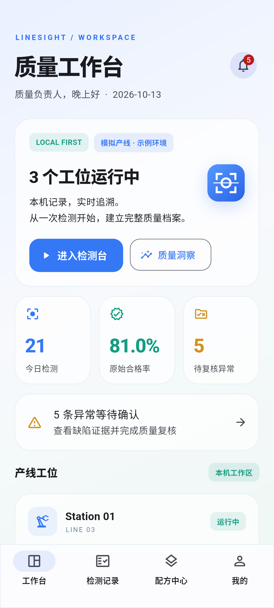

# LineSight

当前界面调整：**1.1.56+8080**，说明见 [界面与导航调整](docs/product/linesight/UI_DELIVERY_20261024.md)。上一轮完整功能清单、测试依据及待验收事项见 [开发收尾报告](docs/product/linesight/CLOSEOUT_20261024.md)。官网 https://99ai.pronhubcn.com/ 当前发布版本仍为 1.1.54+8078。

以下为 1.1.20 及更早版本的历史说明；其中旧版本的本地认证、模拟相机或无云功能描述不代表当前版本，当前能力以收尾报告为准。

Current release: **1.1.20** — [2.8-second particle brand reveal](docs/BRAND_REVEAL.md),
without diagonal reflection stripes, with synchronized Android touch envelopes
and concurrent storage initialization/login layout preloading. Based on 1.1.19.
Active source: `C:/Users/29668/LineSight-workspaces/week6-cloud`.
Packages: `C:/Users/29668/LineSight-releases/1.1.20/`.

## Liquid glass navigation — 1.1.19

Current Android source: `C:/Users/29668/LineSight-workspaces/week6-cloud`.
The phone bottom bar now uses a Flutter adaptation of LiquidGlassBar with backdrop
refraction, press enlargement and drag-to-select. Chinese/English destinations,
the glass switch, reduced motion and tablet navigation are retained.
[Implementation and validation](docs/LIQUID_GLASS_BAR.md).

LineSight is an offline Flutter workspace for production-line quality inspection. Version 1.1 adds local authentication, persistent inspection workflows, recipe configuration, quality statistics, and data management. Version 1.1.9 adds review-draft protection, stale-evidence checks and repeated-query reuse. Worker-based startup validation and accessible loading steps are included. Immutable CSV previews, streaming generation and verified native saving are included. Authenticated startup recovery preserves original data atomically. Complete streaming backups, portable timestamps, audit traceability and item-by-item restore/undo previews are included. The interface is in Simplified Chinese with light/dark glass surfaces and responsive phone/tablet layouts.

## Portable web experience

[Download the static web package](deliverables/week6/LineSight-web-demo.zip), extract it, and open `dist/index.html`. The bright Chinese/English experience connects production jobs, inspection images, recipes and team details. Deploy the complete `dist` folder to static hosting, or build from [`live-demo/`](live-demo/README.md). [Screenshots, navigation diagrams and browser validation](docs/week6/web-demo/README.md).

## Local workspace — version 1.1

- **Accounts:** first-run administrator setup, salted PBKDF2 password verification, recovery codes, password changes, account roles, disabled accounts, login throttling, sign-out, and background locking. No cloud account is required.
- **Inspection:** configurable stations, start/pause, explicit simulated inspections, synthetic part previews, immutable original verdicts and recipe parameter snapshots, defect review with reasons, and audit history.
- **Records:** keyword/station/date/verdict filters, sorting, pagination, bulk archive/restore, and CSV export of filtered or complete records.
- **Recipes:** create/edit/copy/delete, configurable defect classes and thresholds, station changeovers with reasons, and protection for recipes currently in use.
- **Insights:** date and station ranges, original and reviewed yield, daily volume, defect distribution, and chart-to-record drilldowns.
- **Data:** SQLite persistence, validated LSB/JSON backups, restore preview, transactional restore, a local undo point, sample-data management, and storage diagnostics.
- **Traceability:** record/station/recipe histories, searchable audit details, linked objects, before/after values, and original-account attribution for native export results after locking. [1.1.1 changes and compatibility](docs/CHANGELOG_1.1.1.md).
- **Restore workspace:** backup metadata, added/changed/removed object lists, field comparisons, stale-preview protection, persistent restore points, undo previews and local backup-save receipts. [1.1.2 changes](docs/CHANGELOG_1.1.2.md). JSON import/export supports up to 20 MB without truncating history.
- **Time:** UTC storage/export, local calendar filters and statistics, timezone-aware details, legacy-backup interpretation and preserved pre-upgrade originals. [1.1.3 changes](docs/CHANGELOG_1.1.3.md).
- **Complete backups:** streaming LSB files with a 256 MiB format limit, preparation/read progress and cancellation, SHA-256 checks, Android destination readback, and chunked storage for large workspaces and undo points. Compatible JSON remains available up to 20 MiB. [1.1.4 changes and limits](docs/CHANGELOG_1.1.4.md).
- **Startup recovery:** enabled-administrator verification, validated backup selection, explicit recovery preview, atomic original preservation and workspace replacement, recovery history, and byte-exact LSR diagnostic export. Local accounts and their credentials are retained. [1.1.5 behavior and limits](docs/CHANGELOG_1.1.5.md).
- **Experience:** custom vector branding and synthetic workpieces, optional blur, dark mode, haptic feedback, reduced motion, readable empty/error states, and a built-in guide.

On first launch, create an administrator and save the one-time-displayed recovery code. Optionally include 96 marked example inspections. Additional accounts are created in **我的 → 成员与权限**. Every cold start requires local login. All accounts on the device share the same business workspace.

| Capability | Operator | Engineer | Administrator |
|---|---|---|---|
| View records, run simulations, start/pause stations | Yes | Yes | Yes |
| Review, archive, configure recipes/stations, export | — | Yes | Yes |
| Manage accounts, restore, clear sample data | — | — | Yes |

Passwords are derived with PBKDF2-HMAC-SHA256 (210,000 iterations, random 24-byte salt), with computation off the UI thread. Business data is stored in the application's private SQLite database. LSB and JSON exports are unencrypted business backups and exclude account credentials. Android automatic OS backup is disabled. This is an application-level local login, not full disk encryption.

Camera images and inference are explicitly simulated. The app has no real camera connection, cloud sync, MES integration, or cloud authentication. Uninstalling removes local accounts and data; export a business backup first. Recovery codes support password reset and administrator verification for startup recovery while the account remains readable; they do not restore an uninstalled database.



## Contributors

- [chaoyang](https://github.com/ChaoYANG)
- [KrOik](https://github.com/KrOik)

## Project progress — Week 4

| Workstream | Status | Deliverable / evidence |
|---|---|---|
| Flutter UI prototype | Done | Four interactive screens running on Android 16 (API 36) emulator; [source](lib/main.dart), [emulator screenshot](screenshots/android-home.png) |
| Screen redraws | Done | Four editable SVGs in [`design/svg-redraw`](design/svg-redraw/) |
| Week 4 stack research | In progress | [Tech stack deliverable](deliverables/week4/LineSight_Week4_TechStack.pdf); formal team decision and rationale still need to be recorded in the tracker |
| Mentor prototype walkthrough and feedback | Not started | Demo notes, mentor feedback, and three agreed changes |
| Draft 1 evidence trail | Not started | Notes, sketches, Visily, Figma, and Pixso artefacts, labelled to show which stages were used |
| Individual tool practice and learning log | Not started | Per-person Softr practice/certification progress and dated learning notes |
| Kanban and ownership | Not started | Cards with named owner, next action, and status |

Use the [weekly progress tracker](docs/PROJECT_PROGRESS.md) to update evidence, the 3/2/2 working groups, stack decisions, and individual contributions. Planned work remains marked as not started until evidence is added.

## Run on Android

Requirements: Flutter with Dart 3.10 or newer and Android SDK. Development is verified against Flutter 3.44.4 / Dart 3.12.2. The Android runner is included.

```sh
flutter pub get
flutter emulators
flutter run -d <device-id>
```

Runtime packages provide SQLite persistence, password derivation, native file picking/saving, and Flutter's Chinese localization. No network service is required at runtime.

## Checks

```sh
flutter analyze
flutter test test
flutter build apk --debug
```

Run device tests on a disposable emulator using a prebuilt APK with a compatible version code and `flutter drive --keep-app-running`. The default runner cleanup can uninstall the package despite suites using unique database paths. Follow the [Android verification procedure](docs/ANDROID_VERIFICATION.md). Layout tests cover both themes, navigation, detail screens, and narrow/tablet/landscape onboarding. See [implementation and validation notes](docs/LOCAL_WORKSPACE.md).

## Development location

The active source is `C:/Users/29668/LineSight-workspaces/startup-performance`. D: is full and retains the 1.1.6 source snapshot and historical builds. [Current development](docs/CURRENT_DEVELOPMENT.md) · [Startup behavior](docs/CHANGELOG_1.1.7.md) · [Storage investigation](docs/STORAGE_PERFORMANCE.md).

## Installable builds

Version **1.1.9+11** packages, exact source, patch from 1.1.8 and reports:
`C:/Users/29668/LineSight-releases/1.1.9/`.

- `LineSight-1.1.9-arm64-v8a.apk` — ARM64 Android phones.
- `LineSight-1.1.9-x86_64.apk` — x64 Android emulator.
- `LineSight-1.1.9-source.zip` — exact source snapshot.
- `LineSight-1.1.9.patch` — verified full reconstruction from accepted 1.1.8 source.

This checkpoint adds review-draft protection and atomic stale-evidence checks,
reuses repeated record queries and themes, and fixes the preview legend at large
text sizes. Drafts remain in memory. New query misses still scan synchronously.

Android API 24+, target 36, development signing, no Internet permission.
**76 host tests**, clean analysis and **13 Android business scenarios** passed.
Installed x64 bytes were verified. 3 cold-start waits passed; 1 failed. The first post-install wait reported timeout at 20,046 ms. All captured release pages were visually checked. Failed waits remain failures even if a later frame appeared.

[Changes](docs/CHANGELOG_1.1.9.md) · [Validation and hashes](docs/LOCAL_WORKSPACE.md) ·
[Review screenshots](screenshots/v1.1.9/README.md) · [Query measurements](docs/RECORD_SEARCH_PERFORMANCE.md).

First post-install latency and whole-workspace transaction cost remain ongoing
work. SQLite schema 3 and all backup/export formats remain compatible. Native
CSV/LSB picker evidence remains at 1.1.6. Earlier releases are preserved.

## Repository layout

```text
lib/main.dart                         App bootstrap, auth gate, lifecycle lock, navigation
lib/store.dart                        SQLite, local accounts, permissions, transactional operations
lib/models.dart                       Data model, validation, example fixtures
lib/time.dart                         Strict time parsing, UTC storage, local calendar boundaries
lib/state_storage.dart                Transactional chunk storage and legacy-cell reads
lib/recovery_storage.dart             Preserved originals and streaming LSR diagnostic export
lib/stream_backup.dart                LSB streaming format, checksums, progress and cancellation
lib/ui.dart                           Theme, glass panels, vector artwork, shared components
lib/screens/                          Main screens and all secondary workflows
lib/files.dart                        Native CSV / JSON / LSB / LSR file workflows
tool/read_recovery_archive.py          Verify or extract preserved LSR originals offline
test/                                 Data invariants and responsive layout tests
integration_test/                     Real SQLite and visible Android workflow tests
design/svg-redraw/                    Editable SVG screen redraws
screenshots/android-home.png          Emulator screenshot
deliverables/week4/                   Week 4 technology-stack report
docs/PROJECT_PROGRESS.md              Weekly work and contribution tracker
```
