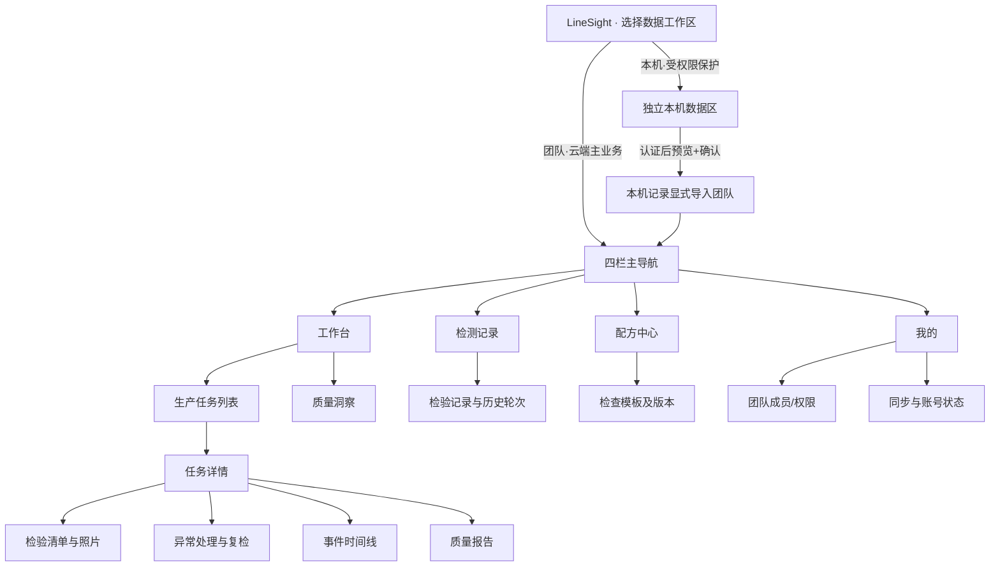
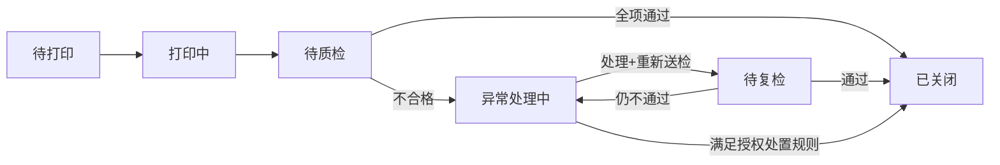

# LineSight — 界面功能方案与持续开发台账

> **版本**：v1.0 · 2026-10-23  
> **方案起点**：Android 1.1.18+4022（debug），现有 Flutter App + HTTPS API + 管理后台<br>
> **当前交付**：Android 1.1.54+8078；2026-10-24 已接入自托管 OTA、正式邮件找回及服务端脱敏日志。逐项状态以配套 Excel 为准，详见[交付状态](DELIVERY_STATUS_20261024.md)。<br>
> **目标**：以小改造构建高感知价值的「任务—质检—异常—复检—报告」体验，持续开发、可追踪、可验证；**不按周排期**。  
> **配套产物**：`LineSight_Development_Backlog.xlsx`（主台账）、`LineSight_Development_Backlog.csv`（导入/协作）、`LineSight_UI_Prototype.html`（离线交互预览）。

## 0. 阅读方式、真实性与更新规范

**项目基线与证据边界**：本方案依据用户提供的 `LineSight_当前App功能与界面梳理(1).md` 及 2026-10-23 审阅结论整理。1.1.18 已有本机工作台/记录/配方/质量洞察、团队注册/邀请/共享任务/人工质检/图片/异常、HTTPS API。**团队与本机账户及数据目前独立**；团队页以任务卡和弹窗为主，静态网页展示不能当做 APK 已实现。已复现的三类缺陷：本机越权导出、401/403 过期处理、异常闭环可绕过及重复覆盖。审阅报告路径 `week6/08_app_review/APP_REVIEW_20261023.md` 来自用户说明；本次未获得该报告文件全文，也未重新运行 APK 或 API。

**状态更新规则（Excel 为唯一主台账）**：

- `待核验`：既有能力有文档依据但当前版本未复测；先验证，不重复造轮子。
- `待开发`：列入待办，尚无当前交付证据；不表示源码一定不存在。
- `开发中`：有工作分支/PR，功能未联调。
- `待联调`：界面/接口完成但未通过跨端联调。
- `待验收`：完成联调、待按清单留证。
- `已验收`：验收标准逐条通过，填写构建版本 + 真实截图/测试/API 响应路径。
- `阻塞`：已复现缺陷或依赖卡住；不能被外观展示判定为完成。

每个台账条目保持固定 ID，负责人、证据路径、状态及备注随着开发更新。完成项**不能直接删除**，以便保留产品决策和测试历史；新需求另建 ID。评审专用示例团队应明确标注「演示数据」，不得混入真实生产统计。静态 HTML 原型仅为交互示意，不连接生产 API。**不宣称 AI 自动判定**，现有 Canny 仅为辅助观察。

## 1. 产品目标与实施取舍

**产品一句话**：让小型制造/3D 打印团队通过手机完成生产任务分配、人工检查、异常整改、复检和质量报告，同时把证据和责任保留下来。

**筛选原则**：优先「现有后端信息可复用 → 页面上变化直观 → 真实存储 → 操作路径短 → 演示可重复」；避免为了评审而创建不可维护的假功能。复杂算法、工业相机和完整 MES 均不进入当前核心路径。

### 1.1 六个评审展示点（高价值/低到中等成本）

| 亮点 | 用户能看到什么 | 最小真实实现 | 评审展示动作 | 前置依赖 |
|---|---|---|---|---|
| 质量驾驶舱 | 指标卡 + 7日趋势 + 我的待办 | 对云端任务/检验做聚合；卡片点击下钻 | 点「待质检」过滤列表 | DAT-01 / REP-01 |
| 生命周期进度条 | 打印→送检→异常/复检→关闭 | 从已有状态枚举渲染，保留异常分支 | 打开任务一眼理解进度 | SEC-03 / UI-03 |
| 检查清单 | 自动加载检查项 + 三态判定 | 3套3-6项 JSON 模板+必填验证+保存 | 选择一项不合格生成异常 | QC-01 / QC-02 |
| 整改证据对比 | 原图/处理后图并排或切换 | 使用现有上传能力，追加阶段标签 | 切换处理前后对比 | QC-07 |
| 个人待办 | 分配给我/待检/待复检 | 按已存在的任务状态、指派关系过滤 | 点任务跳转详情 | UI-06 |
| 一页式质量报告 | 报告预览+打印到PDF | 真实数据填充 HTML 模板、系统打印 | 从任务一键输出报告 | DAT-03 / REP-03 |

**不可低估的硬约束**：安全越权、状态机与重复提交、统一云端记录、离线恢复、数据库迁移/备份等属于底层工作，不能按普通展示小功能估算。先消除阻断，再开放对应的可视化入口。

## 2. 信息架构（不改现有四个主导航）



**导航原则**：工作台保持任务入口及质量概览，检测记录保持可追溯明细，配方中心新增清单模板，我的负责权限/同步；团队工作区不再需要独立一整套孤岛式主视图。暂时保留本机离线能力，但必须有清楚的「本机/团队」来源标签、本机授权门禁和显式导入，不能悄悄混合。

## 3. 视觉规范与交互设计

- **延续而非推翻**：保持现有浅底色、蓝色主动作、白色圆角卡片、充足留白，和手机底部四栏 / 宽屏侧栏的适配。
- **颜色只承载状态**：品牌蓝 `#246BFD`；通过绿 `#14885F`；待处理琥珀 `#D99118`；异常红 `#CC4352`；文本深色 `#18243D`；背景 `#F5F7FB`。
- **间距**：8pt 基线；卡片内 16–20px；列表卡片间 12px；主按钮高度 44–48px；避免靠颜色区分结果，同时显示明确文字与图标。
- **信息层级**：页头（标题+上下文）→ 核心摘要 → 当前推荐操作 → 记录/证据 → 高级管理功能。**每屏只有一个主要 CTA**。
- **详情组织**：任务详情拆为「概览｜质检｜异常｜历史」分段；概览展示步骤条，历史用时间线。危害性操作二次确认，失败后不改变成功状态。
- **反馈**：局部骨架屏 / 上传百分比 / 失败原因 / 可恢复草稿 / 冲突比对；登录过期与权限不足分开提示。
- **动效**：已有触觉/减少动画设置保持生效；粒子 Logo 仅用于启动等短时品牌节点，不加入反光。启动同时执行界面预加载、账号恢复及更新检查，常规操作不用大型过场阻断质检。
- **可访问性**：颜色与标签双重编码、≥44px 触控目标、中英文不溢出、表单屏阅读顺序合理、减少动态效果。

## 4. 页面功能契约

页面定义用于 Flutter 实现、API 对接和视觉验收；不是声称当前 APK 已全部完成。

### SCR-01 · 工作台·质量驾驶舱

- **入口**：四栏主导航-工作台。
- **首屏信息**：数字卡：今日待检/异常处理中/已完成、我的待办、7日折线图、最新任务。
- **主要动作**：查看我的待办/查看全部任务/进入质量洞察。
- **数据来源**：云端聚合任务+检验事件。
- **状态/约束**：空数据时显示引导；切团队自动切换统计。
- **开发 ID**：`UI-01,UI-06,DAT-01`。

### SCR-02 · 生产任务列表

- **入口**：工作台-生产任务入口。
- **首屏信息**：搜索框；按状态/负责人筛选；任务卡显示零件/批次/数量/责任人/当前状态。
- **主要动作**：新建任务/进入详情。
- **数据来源**：云端任务API。
- **状态/约束**：切换过滤保留状态；只读不显示创建。
- **开发 ID**：`UI-02,DAT-05`。

### SCR-03 · 任务详情

- **入口**：任务卡/通知/扫码入口。
- **首屏信息**：页头ID与状态；5阶段进度条；概览/质检/异常/历史；主要CTA。
- **主要动作**：开始打印/送检/检验/处理/打印报告。
- **数据来源**：任务+inspection+issue+event。
- **状态/约束**：所有写操作按后端状态机；409冲突需用户处理。
- **开发 ID**：`UI-03,UI-04,UI-05,SEC-04`。

### SCR-04 · 检验清单

- **入口**：任务详情-质检。
- **首屏信息**：产品/批次/轮次；照片区；检查项Pass/Fail/NA；备注与数量；结果摘要。
- **主要动作**：拍照/提交检验。
- **数据来源**：模板版本快照+检验记录+图片。
- **状态/约束**：必填未完成无法提交；发现NG须创建异常。
- **开发 ID**：`QC-01,QC-02,QC-04,QC-05`。

### SCR-05 · 异常处置

- **入口**：任务详情-异常。
- **首屏信息**：异常类型/严重度/责任人；处理说明；整改前后照片；事件列表。
- **主要动作**：提交处理/复检/授权关闭。
- **数据来源**：issue+action+evidence+inspection。
- **状态/约束**：未处理不可关闭；重复提交不可覆盖。
- **开发 ID**：`QC-06,QC-07,QC-08,SEC-03`。

### SCR-06 · 检测记录·追溯

- **入口**：四栏主导航-检测记录。
- **首屏信息**：时间/人员/批次/结论过滤；每条检验轮次、来源、图片与标准快照。
- **主要动作**：查看检验详情/导出。
- **数据来源**：云端真实检验表。
- **状态/约束**：原结论与最终结论区分；示例数据隔离。
- **开发 ID**：`DAT-02,QC-05,REP-04`。

### SCR-07 · 质量洞察

- **入口**：工作台-质量洞察。
- **首屏信息**：首次通过率、最终放行率、缺陷量、异常时长；趋势与分布；过滤。
- **主要动作**：图表下钻/报告预览。
- **数据来源**：同一查询与统计口径。
- **状态/约束**：0分母显示—；数量是工件而非任务。
- **开发 ID**：`REP-01,REP-02,DAT-03`。

### SCR-08 · 质量报告

- **入口**：任务详情-报告。
- **首屏信息**：报告编号；任务批次与检验人；统计；缺陷与处理；证据缩略图与版本。
- **主要动作**：打印/导出CSV/复制追溯码。
- **数据来源**：真实任务+检验+证据数据。
- **状态/约束**：云端权限校验；标注来源和筛选范围。
- **开发 ID**：`REP-03,REP-04`。

### SCR-09 · 成员与团队

- **入口**：我的-团队管理。
- **首屏信息**：团队选择；成员列表；角色标记；邀请入口；角色变更/移除。
- **主要动作**：邀请/改权/移除。
- **数据来源**：成员和权限API。
- **状态/约束**：仅管理员写；改权后旧会话访问被撤销。
- **开发 ID**：`COL-01,COL-04,SEC-05`。

### SCR-10 · 我的·账户与同步

- **入口**：四栏主导航-我的。
- **首屏信息**：登录态/来源标签；同步队列；登录恢复；安全与诊断；中英文/触觉设置。
- **主要动作**：重试/重新登录/切换语言。
- **数据来源**：本机受控数据+云端会话+草稿。
- **状态/约束**：拒绝本机越权导出；断网草稿可恢复。
- **开发 ID**：`SEC-01,SEC-02,OFF-01`。

### SCR-11 · 配方中心·检查模板

- **入口**：四栏主导航-配方中心。
- **首屏信息**：保留现有配方/换型/系统段；为配方增加检查清单与版本。
- **主要动作**：配置模板/复制/关联工位。
- **数据来源**：配方配置+检查模板。
- **状态/约束**：已提交检验保留原模板快照。
- **开发 ID**：`QC-01`。

## 5. 核心流程与服务端约束

### 5.1 真实业务状态机（建议）



**后端不变量**：只能由合法角色触发合法状态转换；未满足异常处理要件不能关闭；关闭任务不可被旧请求重开；异常处理和复检只追加记录，不改旧检验；请求幂等键保证重试不重复；任务/检验/异常均按 team/workspace 对象级鉴权；冲突以版本号返回409。**HTTP 401 用于缺失/无效身份，403 用于身份有效但权限不足；如果已有服务端用403表示过期，要同步修正服务端契约，客户端按结构化错误码恢复。**

### 5.2 统一业务对象（尽量复用，避免过度设计）

| 对象 | 必要字段（最小） | 说明 |
|---|---|---|
| Workspace/Member | workspace_id,user_id,role,status | 统一团队作用域与即时撤权 |
| Task | id,workspace_id,part_name,planned_qty,batch_code,status,assignee_id,version | 已有任务扩字段，版本支持并发 |
| Inspection | id,task_id,round_no,template_version,inspected_qty,pass_qty,fail_qty,result,inspector_id,created_at | 每次提交是一条新轮次，不覆写 |
| ChecklistResult | inspection_id,item_key,label_snapshot,result,remark | 结果为 pass/fail/na，保存历史标准快照 |
| Issue / Resolution | id,inspection_id,category,severity,assignee_id,status,action,disposition | 处理动作追加历史，完成须校验状态 |
| Evidence | id,workspace_id,task_id,inspection_id/issue_id,stage,url,sha256,uploaded_by | `stage` 如 before/after/inspection；受限访问 |
| ActivityEvent | id,workspace_id,entity_type,entity_id,actor_id,action,before/after,at | 支撑时间线和审计；只增不改 |
| Draft / UploadJob | local_id,target_id,payload_ref,upload_state,idempotency_key | 本机受保护存储；退出/撤权清理访问能力 |

**量的口径**：一个任务可包含若干件工件；产品首期可用批次级数量，无需所有件都建独立 SN。质量指标按照检验工件/批次规则统计，而不是把“任务条数”充当“工件数”。返工再次检测单独计轮次，不重复计入首次检验分母。所有报告展示统计时间区间、数据来源、生成时间及检验标准版本。

### 5.3 UI 交互条件

| 事件 | 前置条件 | 成功反馈 | 失败/阻断反馈 |
|---|---|---|---|
| 提交检查表 | 已登录、有权限、必填完成、有合法状态 | 新增 Inspection + 可追踪记录 | 定位缺少的检查项，保留草稿 |
| 录入异常 | 有不合格项/人工异常说明 | 新增 Issue + 指派待办 | 数量/负责人/权限校验，不能直接关闭 |
| 提交处置 | 责任人或授权角色、处置文字和依据完整 | 转入待复检或受控终结 | 显示缺失证据，不覆盖旧记录 |
| 完成复检 | 待复检且模板检查完整 | 创建新轮次并更新当前任务状态 | 版本冲突→刷新当前状态→重新确认 |
| 导出本机记录 | 本机认证及相应角色权限 | 显示范围预览/来源，执行导出 | 未认证拒绝；云端登录不能替代本机授权 |
| 导出团队报告 | 有团队读取/导出权限 | 生成与统计同口径报告 | 身份失效重认证，跨团队拒绝 |

## 6. 可重复的评审演示脚本（不代表正式功能已实现）

选用独立的 **DEMO 工作区**，准备几条明示的演示任务：一条完成、一条异常处理中、一条待检；分别有真实上传的演示图片和检验记录。禁止示例数据混入真实生产环境。每次演示前恢复演示团队到预设状态，演示中所有实际操作须写入该演示团队 API。

**01 · 开启质量工作台**：进入演示专用团队，展示今日待检、异常处理中、首次通过率。  
验收点：云端聚合数字，可点到原始列表。关联 `UI-01,REP-01`。建议留存：工作台完整截图+API统计响应。

**02 · 定位一项真实任务**：筛选我的任务，打开任务详情，展示状态进度和历史。  
验收点：状态及事件来自服务器，不写死。关联 `UI-02,UI-03,UI-04,UI-05`。建议留存：任务详情截图。

**03 · 执行标准化检验**：加载PLA检查模板，拍照，选择一项不合格，提交。  
验收点：未填必填禁止提交，NG产生异常单。关联 `QC-01,QC-02,QC-04`。建议留存：质检前后截图+inspection ID。

**04 · 演示整改与复检**：指定责任人，提交处理说明和前后证据，重新送检再检通过。  
验收点：原不合格结论仍然可查看，禁止绕过。关联 `QC-05,QC-07,QC-08`。建议留存：异常详情+两轮检验记录。

**05 · 生成报告与核验数据**：打开质量洞察，点击指标下钻，生成本次任务质量报告。  
验收点：指标、明细、导出数量一致。关联 `REP-01,REP-02,REP-03`。建议留存：打印到PDF的报告样例。

**06 · 证明多人协作与安全**：第二部设备查看最新结果；尝试非法关闭或撤权后的更新。  
验收点：服务端拒绝非法操作，不止前端隐藏按钮。关联 `SEC-03,SEC-05,QA-01`。建议留存：双机录像+负例API日志。

## 7. 持续开发清单（仓库摘要版）

**优先级定义**：`P0` 安全/可用性/数据完整性或验收阻断；`P1` 高展示收益与关键体验；`P2` 有价值但可延期。**实现复杂度（1最小～5最大）不是时间承诺**，只用于粗排。高展示价值≠放宽测试；安全修复和真实数据流不可跳过。

### 安全与权限

- [ ] **SEC-01** · 本机记录导出必须经过本机认证｜**P0**｜状态：阻塞｜展示价值 5/5｜复杂度 2/5  
  **验收**：未登录本机账户从团队入口无法读取、预览或导出本机受保护记录；管理员与工程师权限定制仍生效。依赖：`无`。
- [ ] **SEC-02** · 登录过期恢复与401/403语义｜**P0**｜状态：阻塞｜展示价值 5/5｜复杂度 2/5  
  **验收**：令牌无效/过期走统一重认证；403权限不足不误判为过期；恢复后不丢本地草稿。依赖：`无`。
- [ ] **SEC-03** · 后端强约束任务与异常状态机｜**P0**｜状态：阻塞｜展示价值 5/5｜复杂度 4/5  
  **验收**：待处理异常不能直接关闭；任务已关闭不可被普通更新重新打开；每条非法操作有负例测试。依赖：`无`。
- [ ] **SEC-04** · 重复提交防重与并发版本号｜**P0**｜状态：阻塞｜展示价值 4/5｜复杂度 4/5  
  **验收**：相同幂等键只生成一次业务结果；旧版本更新返回409；重复提交不能覆盖已关闭结论。依赖：`SEC-03`。
- [ ] **SEC-05** · 成员移除改权即时撤权｜**P0**｜状态：待开发｜展示价值 4/5｜复杂度 3/5  
  **验收**：移除/离组/权限降级后，旧令牌访问该团队任务、图片和导出接口均被拒绝。依赖：`COL-01`。
- [ ] **SEC-06** · 全对象授权与图片证据隔离｜**P0**｜状态：待核验｜展示价值 4/5｜复杂度 4/5  
  **验收**：跨团队替换任务ID/图片ID/检验ID/导出参数无法读取与写入；导出仅按授权数据范围。依赖：`SEC-05`。

### 云端统一数据

- [ ] **DAT-01** · 首页/任务/记录采用团队数据源｜**P0**｜状态：待开发｜展示价值 5/5｜复杂度 4/5  
  **验收**：同团队两台手机同一筛选条件下任务、检验列表和首页指标一致。依赖：`SEC-01`。
- [ ] **DAT-02** · 云端检验记录与证据关联｜**P0**｜状态：待开发｜展示价值 5/5｜复杂度 4/5  
  **验收**：每次检验有唯一ID、任务ID、人员、时间、结果和关联图片；重试不重复产生记录。依赖：`DAT-01`。
- [ ] **DAT-03** · 统计与导出使用相同查询口径｜**P0**｜状态：待开发｜展示价值 5/5｜复杂度 3/5  
  **验收**：统计卡、缺陷图、CSV/PDF使用同一权限范围及过滤条件，逐项数值对得上。依赖：`DAT-01,DAT-02`。
- [ ] **DAT-04** · 本机/团队模式显式隔离及受控导入｜**P0**｜状态：待核验｜展示价值 4/5｜复杂度 3/5  
  **验收**：首页明确数据来源；本机导入需本机授权、预览、确认；示例数据默认排除；重复导入不重复。依赖：`SEC-01`。
- [ ] **DAT-05** · 数量/批次基础字段与合法性校验｜**P0**｜状态：待开发｜展示价值 5/5｜复杂度 3/5  
  **验收**：任务计划数、送检数、合格/异常/报废数不出现不合理越界；支持批次号。依赖：`DAT-02`。
- [ ] **DAT-06** · 稳定标识和可追溯审计事件｜**P0**｜状态：待开发｜展示价值 5/5｜复杂度 3/5  
  **验收**：每次状态变化创建只增不改事件；保留actor/time/object/version；查询按团队隔离。依赖：`DAT-02`。

### 质检与异常

- [ ] **QC-01** · 配方关联轻量检查清单模板｜**P1**｜状态：待开发｜展示价值 5/5｜复杂度 2/5  
  **验收**：至少3套模板，每套3-6项；有模板版本与必填定义；修改模板不更改历史检验快照。依赖：`DAT-02`。
- [ ] **QC-02** · 逐项合格/不合格/不适用录入｜**P0**｜状态：待开发｜展示价值 5/5｜复杂度 2/5  
  **验收**：未填必填项禁止提交；不合格项需要问题备注或异常说明；保存为真实检验记录。依赖：`QC-01`。
- [ ] **QC-03** · 批次检验与工件SN可选模式｜**P1**｜状态：待开发｜展示价值 4/5｜复杂度 3/5  
  **验收**：按批次录数量或按单件SN录入；二者不会重复统计同一工件。依赖：`DAT-05`。
- [ ] **QC-04** · App内拍照与图片预览｜**P1**｜状态：待开发｜展示价值 5/5｜复杂度 2/5  
  **验收**：Android拍照/相册二选一；10MB和16MP限制、压缩与失败反馈按实际契约；证据与检验ID绑定。依赖：`DAT-02`。
- [ ] **QC-05** · 检验轮次与历史结论不可覆盖｜**P0**｜状态：待开发｜展示价值 5/5｜复杂度 4/5  
  **验收**：每次复检创建新轮次；原结论/图片/检查项原样可查；关闭后一般用户不可编辑历史。依赖：`SEC-03,DAT-02`。
- [ ] **QC-06** · 异常分类、严重程度与责任人｜**P1**｜状态：待开发｜展示价值 5/5｜复杂度 2/5  
  **验收**：缺陷类别、严重度、指派人、创建人、处置说明完整；筛选异常类别可用。依赖：`QC-02`。
- [ ] **QC-07** · 整改证据前后对比｜**P1**｜状态：待开发｜展示价值 5/5｜复杂度 2/5  
  **验收**：同一异常支持整改前/整改后各至少一张；两张可放大、可切换；无证据时正确显示空状态。依赖：`QC-04,QC-05`。
- [ ] **QC-08** · 异常处置与复检门禁｜**P0**｜状态：阻塞｜展示价值 5/5｜复杂度 4/5  
  **验收**：异常处理后只能依业务规则进入待复检/授权关闭；审核关闭保留处置依据和角色记录。依赖：`SEC-03,QC-05`。
- [ ] **QC-09** · 边缘预览明确标注非AI判断｜**P0**｜状态：待核验｜展示价值 4/5｜复杂度 1/5  
  **验收**：所有入口清楚标注“边缘参考/人工判断”；正式报告不出现自动AI判定措辞。依赖：`QC-04`。

### 界面与交互

- [ ] **UI-01** · 工作台质量驾驶舱卡片｜**P1**｜状态：待开发｜展示价值 5/5｜复杂度 2/5  
  **验收**：展示今日待检、异常处理中、已关闭及7日趋势；点击数字进入带同条件筛选列表。依赖：`DAT-01,DAT-03`。
- [ ] **UI-02** · 任务列表筛选与快速搜索｜**P1**｜状态：待开发｜展示价值 4/5｜复杂度 1/5  
  **验收**：至少状态/负责人/任务号筛选，保留空状态、加载态和刷新入口。依赖：`DAT-01`。
- [ ] **UI-03** · 独立任务详情页｜**P0**｜状态：待开发｜展示价值 5/5｜复杂度 3/5  
  **验收**：顶部概要；概览/质检/异常/历史4段；任务不同状态显示正确主操作。依赖：`DAT-02`。
- [ ] **UI-04** · 横向生命周期进度条｜**P1**｜状态：待开发｜展示价值 5/5｜复杂度 1/5  
  **验收**：步骤：待打印→打印中→待质检→异常处理/复检→已关闭；当前节点与异常分支准确。依赖：`UI-03`。
- [ ] **UI-05** · 事件时间线与操作者头像｜**P1**｜状态：待开发｜展示价值 5/5｜复杂度 1/5  
  **验收**：时间线由真实事件生成，按时间排序，展示操作者及状态变化，不用前端虚构事件。依赖：`DAT-06,UI-03`。
- [ ] **UI-06** · 我的待办三分类｜**P1**｜状态：待开发｜展示价值 5/5｜复杂度 1/5  
  **验收**：待质检/待异常处理/待复检由角色和负责人查询生成；每项可直达任务详情。依赖：`UI-02,QC-06`。
- [ ] **UI-07** · 图片证据灯箱与局部放大｜**P1**｜状态：待开发｜展示价值 4/5｜复杂度 2/5  
  **验收**：支持缩放、原图/边缘预览切换、上传状态与失败重试。依赖：`QC-04`。
- [ ] **UI-08** · 统一空态/加载/错误/成功反馈｜**P1**｜状态：待开发｜展示价值 4/5｜复杂度 1/5  
  **验收**：云端断网、未授权、无数据、冲突、上传失败分别给清楚的可执行操作。依赖：`SEC-02`。
- [ ] **UI-09** · 任务二维码/可复制追溯号｜**P2**｜状态：待开发｜展示价值 4/5｜复杂度 1/5  
  **验收**：生成任务或报告追溯码；扫码访问仍需授权；提供复制任务ID。依赖：`UI-03`。
- [ ] **UI-10** · 品牌触觉反馈与减少动态效果｜**P2**｜状态：待核验｜展示价值 3/5｜复杂度 2/5  
  **验收**：成功/警告反馈区分；减少动画设置有效；动效不会遮挡业务提交或误报成功。依赖：`UI-03`。
- [ ] **UI-11** · 中英文全业务流程与文案排版｜**P1**｜状态：待开发｜展示价值 4/5｜复杂度 2/5  
  **验收**：任务、检验、异常、报告及错误提示全链路双语可用；小屏无文本溢出。依赖：`UI-03,QC-02`。

### 团队与账户

- [ ] **COL-01** · 成员移除/改权/离组管理｜**P0**｜状态：待开发｜展示价值 4/5｜复杂度 3/5  
  **验收**：管理员可改角色与移除成员；自删与最后一位管理员处理有明确规则；服务端即时撤权。依赖：`SEC-06`。
- [ ] **COL-02** · 云端密码修改/找回与会话续期｜**P0**｜状态：待开发｜展示价值 4/5｜复杂度 4/5  
  **验收**：支持密码重置与修改、令牌续期/重新登录、撤销旧会话；密钥安全持久化。依赖：`SEC-02`。
- [ ] **COL-03** · 任务指派与应用内通知｜**P1**｜状态：待开发｜展示价值 5/5｜复杂度 2/5  
  **验收**：任务分配/异常交接形成通知条目，可标已读并跳转对象；无需先上推送服务。依赖：`UI-06`。
- [ ] **COL-04** · 团队切换及只读角色完整界面｜**P1**｜状态：待核验｜展示价值 4/5｜复杂度 2/5  
  **验收**：切换团队不会串数据；viewer所有写按钮隐藏/禁用且API拒绝写入。依赖：`COL-01`。

### 质量报告

- [ ] **REP-01** · 核心质量指标计算口径｜**P0**｜状态：待开发｜展示价值 5/5｜复杂度 2/5  
  **验收**：统一定义首次通过率/最终放行率/异常处理时间等分子分母；0分母显示暂无数据。依赖：`DAT-03,DAT-05`。
- [ ] **REP-02** · 7日趋势与缺陷类别分布｜**P1**｜状态：待开发｜展示价值 5/5｜复杂度 2/5  
  **验收**：趋势图与缺陷分布按同一过滤条件生成，点击图表能下钻到检验记录。依赖：`REP-01`。
- [ ] **REP-03** · 一页式质量报告预览与打印｜**P1**｜状态：待开发｜展示价值 5/5｜复杂度 2/5  
  **验收**：报告包含任务/批次/检验结论/异常处置/证据索引/出具时间/操作者；支持系统打印至PDF。依赖：`DAT-03,QC-05`。
- [ ] **REP-04** · CSV与报告权限及来源说明｜**P0**｜状态：待开发｜展示价值 4/5｜复杂度 2/5  
  **验收**：导出不得越权；注明团队或本机数据来源、统计口径与筛选范围；示例不混入真实数据。依赖：`SEC-01,DAT-03`。

### 断网与冲突

- [ ] **OFF-01** · 检验草稿断网持久化｜**P0**｜状态：待开发｜展示价值 4/5｜复杂度 4/5  
  **验收**：杀进程后可恢复待提交检查结果与照片关联信息；未上传与已上传状态清晰。依赖：`DAT-02`。
- [ ] **OFF-02** · 图片上传重试和幂等队列｜**P0**｜状态：待核验｜展示价值 4/5｜复杂度 4/5  
  **验收**：弱网重试不重复照片、不丢附件；网络恢复后可手动继续并显示队列状态。依赖：`SEC-04,OFF-01`。
- [ ] **OFF-03** · 两人同时编辑冲突检测与恢复｜**P0**｜状态：待开发｜展示价值 4/5｜复杂度 3/5  
  **验收**：后提交者看到最新版本对比并选择刷新/重新提交；不静默覆盖另一人的结果。依赖：`SEC-04`。

### 发布与恢复

- [ ] **REL-01** · 正式签名Android release包｜**P0**｜状态：待开发｜展示价值 4/5｜复杂度 3/5  
  **验收**：release签名、生产配置、版本升级可安装；不携带调试密钥/演示固定凭证。依赖：`SEC-01,SEC-02,SEC-03`。
- [ ] **REL-02** · 数据库及图片备份恢复演练｜**P0**｜状态：待开发｜展示价值 4/5｜复杂度 4/5  
  **验收**：按演练记录备份→恢复→校验任务、检验、图片关联和权限；有回滚方案。依赖：`DAT-02`。
- [ ] **REL-03** · 数据库迁移与旧版本升级验证｜**P0**｜状态：待开发｜展示价值 4/5｜复杂度 4/5  
  **验收**：旧APP/旧数据库升级后账户、任务和记录无损；回滚前提明确。依赖：`DAT-05,REL-01`。
- [ ] **REL-04** · 服务健康、错误定位与脱敏日志｜**P1**｜状态：待开发｜展示价值 3/5｜复杂度 3/5  
  **验收**：能定位登录失败、写入冲突、上传失败及服务器不可达，不打印密码和令牌。依赖：`SEC-02`。

### 验收与证据

- [ ] **QA-01** · 双真机跨账号端到端协作｜**P0**｜状态：待开发｜展示价值 5/5｜复杂度 3/5  
  **验收**：两台真实Android机创建→指派→检验→异常→复检→报告，数据与权限一致。依赖：`DAT-03,SEC-05,QC-08`。
- [ ] **QA-02** · 负面测试覆盖漏洞与状态机｜**P0**｜状态：待开发｜展示价值 4/5｜复杂度 3/5  
  **验收**：权限绕过/403-401/非法关闭/重复提交/越权ID/并发冲突至少各一条回归测试。依赖：`SEC-01,SEC-02,SEC-03,SEC-04`。
- [ ] **QA-03** · 至少10名外部用户任务测试｜**P0**｜状态：待开发｜展示价值 4/5｜复杂度 3/5  
  **验收**：每名用户完成指定场景，记录任务完成率、问题、修复与复测；真实手机英文流程覆盖。依赖：`UI-03,QC-02,REP-03`。
- [ ] **QA-04** · 统一演示工作区与成果证据索引｜**P1**｜状态：待开发｜展示价值 5/5｜复杂度 1/5  
  **验收**：演示数据明确标注并与真实统计隔离；脚本对应截图/录屏/API请求与测试记录。依赖：`QA-01`。

## 8. 负面测试与验收矩阵

上线验收必须具备可复现的负例，不以“按钮隐藏”替代权限与状态验证。每条用例填写设备、App 版本、服务版本、截图、测试请求和结果。

| Case | 检验目标 | 关联 ID | 核心预期 |
|---|---|---|---|
| AT-01 | 本机越权导出 | `SEC-01` | 本机导出/预览/读取入口均拒绝；不泄露条数和内容 |
| AT-02 | 403和401语义 | `SEC-02` | 失效令牌重认证；真正403展示无权限，均不会形成登录死循环 |
| AT-03 | 异常未处理禁止关闭 | `SEC-03,QC-08` | 前端及直接API绕过都不能关闭 |
| AT-04 | 关闭任务不可重开 | `SEC-03` | 后端拒绝；最终状态和检验结果不变 |
| AT-05 | 幂等请求 | `SEC-04` | 同一请求键只产生一次业务结果 |
| AT-06 | 并发冲突 | `SEC-04,OFF-03` | 后提交旧版本返回409，显示刷新操作 |
| AT-07 | 跨团队访问 | `SEC-06` | 图片、任务、记录、导出均拒绝 |
| AT-08 | 成员离组撤权 | `SEC-05,COL-01` | 旧令牌不能继续写/读取已取消授权的私有资源 |
| AT-09 | 跨手机数据一致 | `DAT-01,DAT-03` | 任务、质检、图表、导出数字一致 |
| AT-10 | 检查项验证 | `QC-01,QC-02` | 不能提交并高亮遗漏检查项 |
| AT-11 | 异常复检留痕 | `QC-05,QC-08` | 首检/处理/复检记录均存在，最终状态正确 |
| AT-12 | 批次数量守恒 | `DAT-05,QC-03` | 数量不能越界，同一工件未重复统计 |
| AT-13 | 照片失败恢复 | `QC-04,OFF-02` | 文件被正确恢复或报错；不会出现两份图片 |
| AT-14 | 草稿恢复 | `OFF-01` | 再打开仍可恢复表单与待上传证据指针 |
| AT-15 | 统计口径一致 | `DAT-03,REP-01,REP-03` | 卡片、明细、CSV、报告按同范围一致 |
| AT-16 | 中英双语 | `UI-11` | 没有未翻译关键文案、文字溢出和日期格式错误 |
| AT-17 | 旧版本升级与恢复 | `REL-02,REL-03` | 数据及图片能恢复，旧版历史未丢失 |
| AT-18 | 外部用户完成流程 | `QA-03` | 问题有来源、修复证据和复测结果 |

## 9. Issue 格式与证据归档

### 9.1 新开发单模板

```yaml
id: UI-03
name: 独立任务详情页
state: 待开发  # 待核验 / 待开发 / 开发中 / 待联调 / 待验收 / 已验收 / 阻塞
priority: P0
owner: ""
links:
  code: ""
  pull_request: ""
  design: "LineSight_UI_Prototype.html"
  acceptance: "LineSight_Development_Backlog.xlsx"
evidence:
  android_screenshot: ""
  backend_test: ""
  two_device_video: ""
notes: ""
```

### 9.2 建议仓库结构

```text
docs/product/linesight/
├── LINE_SIGHT_PRODUCT_PLAN.md         # 本文件，说明为什么/做什么/怎么验收
├── LineSight_Development_Backlog.xlsx # 开发状态主台账（每次更新）
├── LineSight_Development_Backlog.csv  # GitHub issue/其他系统导入备份
├── LineSight_UI_Prototype.html        # 离线可点击界面原型（非生产App）
├── decisions/                          # 架构/视觉重要决策记录
└── acceptance/
    ├── SEC-01/                       # 请求日志、权限负例、截图
    ├── QC-05/                        # 前后两轮检验与数据库记录
    └── QA-01/                        # 两手机协作录屏和验证结果
```

**每次完成一个功能**：① 按固定 ID 提交代码；② 填写或更新测试；③ 获取真实截图/API 证据；④ Excel 状态置为 `已验收` 并保存路径；⑤ 更新原型仅反映已实现的交互。**任何新的静态页面不自动等于功能完成。**

## 10. 明确延后范围

AI 自动质检、工业相机实时采集、打印机远程控制、企业级 MES/ERP、复杂预测预警、审批签名、设备联网控制均列为后续独立范围；不在本次评审核心承诺内。现有边缘参考是图像辅助观察，不当作已完成的 AI 能力。课程核心功能固定为：**① 生产任务管理；② 质检与异常闭环；③ 质量统计与追溯报告。**

## 11. 变更记录

| 版本 | 日期 | 变更 |
|---|---|---|
| v1.0 | 2026-10-23 | 建立界面功能规格、演示价值选型、带 ID 的开发台账、状态机及验收用例；不设按周计划。 |
