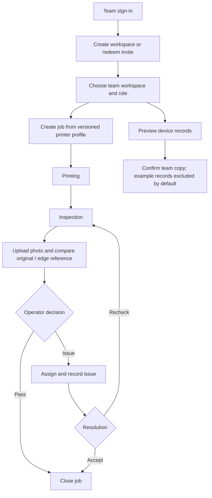
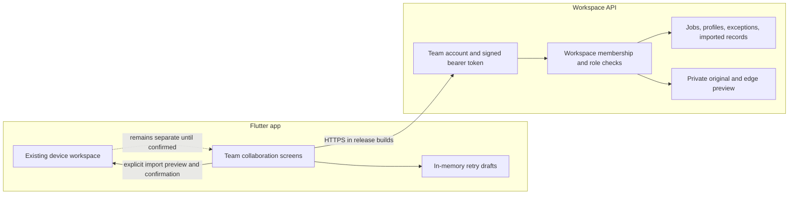

# Feature 2 design v3 — team production and quality handoff

**Product:** LineSight, a production quality workspace for small manufacturing teams.
**Build:** 1.1.18+4022 (debug; deployed HTTPS API preconfigured).
**Design focus:** one connected journey for team jobs, evidence, and follow-up, with device records kept distinct until the user chooses to import them.
**Visual direction:** existing bright blue and green palette, white cards, light background, consistent Chinese/English copy.

## User need

Operators need to know what is being printed, which printer profile was selected, whether quality review is complete, and who owns an open issue. Team members should see the same job and evidence inside their workspace. People using the device workspace should be able to inspect the records they would share before creating a team copy.

## Entry points and account choice

- The sign-in screen offers a separate team-workspace entry. Team access does not require signing into the device account first.
- The settings page also links to Team workspace for people already using the local workbench.
- The first team screen explains that device records stay on the device until the user previews and confirms an import.
- Team credentials are separate from device credentials. A team access token stays in memory for the app session and expires after one hour; it is cleared after an authorization failure or sign-out.
- Service URL is blank in the normal interface and comes from the workspace administrator. The local verification build can supply its endpoint through a build-time setting without exposing that address in the screen.

## Team flow

1. Create a team account or sign in.
2. Create a workspace or redeem a one-use invitation. An owner can invite an operator or a view-only member; invitations expire after 48 hours. Repeating redemption from the same account is safe after a lost response, while another account cannot reuse the code.
3. Select a workspace to see its role, members, printer profiles, shared jobs, and imported legacy inspection summaries.
4. Create a job by choosing a starter printer profile or an owner-managed workspace profile. The job retains the profile version and its source URL.
5. Move the job through queued → printing → inspection. Add a PNG/JPEG photo while in inspection. Review the original beside the edge reference; the operator makes the quality decision.
6. Close a passed job or record an issue, assign it to a workspace member, and return it to inspection or close it with a resolution.
7. If a request response is lost, retry the same job or photo. Stable request identifiers prevent duplicate jobs or image evidence. Legacy records are imported in size-bounded batches and keyed by source ID, so repeating the import does not create duplicates.

## Information architecture

- **Team workspace picker:** workspace name, role, create workspace, invitation code, sign-out.
- **Workspace detail:** member-visible role and member list; owner-only invitation and profile management; team job list; imported record count and latest 100 summaries.
- **Job card:** part, quantity, printer/profile version and source, status, note, exception and assignee, evidence preview, and the next allowed action only.
- **Import preview:** eligible local record count, pass/issue totals, date range, example-record toggle (off by default), and an explicit confirmation. The user sees the created/skipped count afterward. Local records are retained.
- **Image review:** the uploaded original and Canny edge reference are labeled separately. Supporting imagery never sets a pass/fail result.

## Roles

| Role | View workspace and jobs | Create/update jobs, upload evidence, resolve issues | Invite members and maintain profiles |
|---|---|---|---|
| Owner | Yes | Yes | Yes |
| Operator | Yes | Yes | No |
| Viewer | Yes | No | No |

The service checks membership and role for every workspace request; hiding an app button is not the authorization boundary.

## Data and service boundaries

The current service implementation uses SQLite and private local media for repeatable development checks. The app connection and team workflows are implemented; production PostgreSQL tenant schemas, deployment, key management, backups, and external HTTPS have not been verified. No production-service claim is made.

## Customer-facing design refinements

- Keep local and team records separate and label the explicit import action. Never silently upload a device workspace.
- Keep account entry and job actions short. Show only the next valid state change to reduce accidental transitions.
- Put the profile version/source next to the job so the team can identify the selected setup later.
- Make ownership visible on issues and show the resolution beside the original issue.
- Explain image limits before the user selects a file; retain a selected upload in the current screen after a network failure and offer retry.
- Keep the edge image visually secondary and label the operator as the decision maker.
- Preserve bright colors, large touch targets, simple cards, and complete Chinese/English labels. No dark-only or implementation-oriented copy is added to product screens.

## Customer review follow-up — 2026-10-21

Reviewing the actual Chinese Android journey exposed two details that made the shared-work experience harder to scan than the design suggested: API role values (`owner`, `operator`, `viewer`) appeared as raw English in a Chinese interface, and the job card's timestamp was displayed as a raw UTC ISO string. The interface now maps those roles to concise localized labels, formats inspection times in the device's local date/time format, and identifies the evidence action as opening both the original photo and its edge reference.

The workspace screen now includes a compact member list with each person's localized role. This helps an operator confirm who can act on a job before assigning an issue, and makes the workspace's shared ownership visible without adding another navigation destination. The flow remains: choose a workspace → create and advance a job → add/view evidence → decide pass or record an issue → resolve and close. Device records remain separate unless the user previews and confirms an import.

The refreshed screenshots use Chinese workspace and part names and show a localized role, member list, readable local timestamp, and two-image review action. Product-created labels are localized; user-entered names remain as entered by the team. Printer brand/model names and source URLs are retained as identifiers. See `android-team-inspection.png`, `android-team-image-review.png`, and `android-team-final.png` in the screenshot folder.

## Self-test evidence

See `../05_testing/test-matrix.md` for backend authorization, invitation replay, workspace isolation, profile source/version, import deduplication, image validation, retry, and Android journey results. Screenshots for the actual team path are indexed in `../04_screenshots/README.md`.

## Remaining product readiness work

- Token refresh and secure persistence across process restarts.
- Production Django migrations and PostgreSQL tenant isolation.
- Deployed HTTPS service, key rotation, private media storage, backup/restore, monitoring, and rollback.
- External user testing after the production service path is ready.
