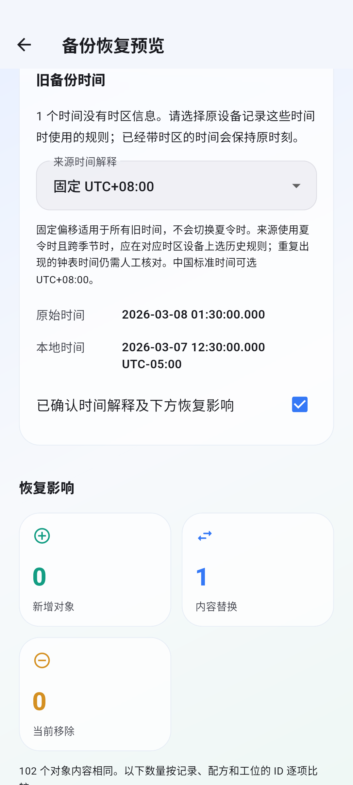
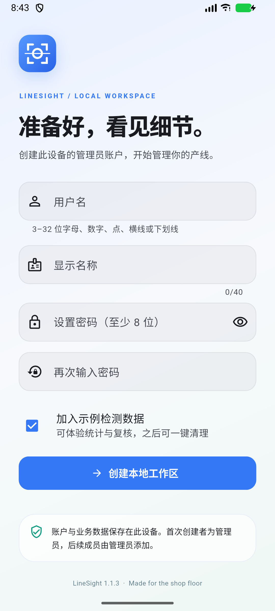

# LineSight 1.1.3

Actual Android emulator captures from the timestamp portability journey. The emulator used `America/New_York` during this test, then its previous timezone (`GMT`) was restored. The example deliberately interprets an old clock time as fixed UTC+08:00 and displays the corresponding New York local time.

Generated by `integration_test/time_portability_test.dart` with `--dart-define=CAPTURE_TIME=true` and the screenshot driver. This journey also checks UTC equality, 23/25-hour calendar dates, transactional migration rollback, retained originals after reopening, selection before restore and the resulting audit entry.

Final 1.1.3 release cold launch:

