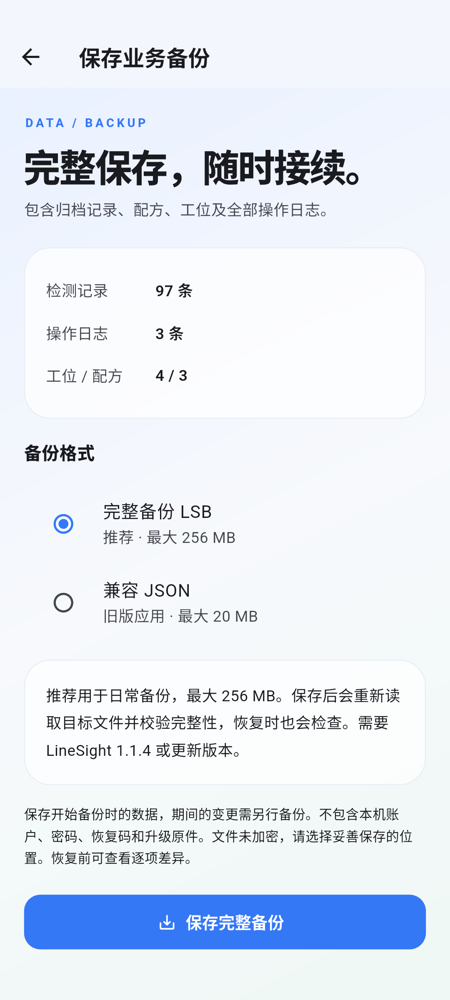
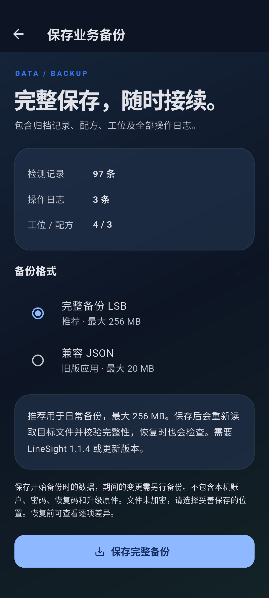
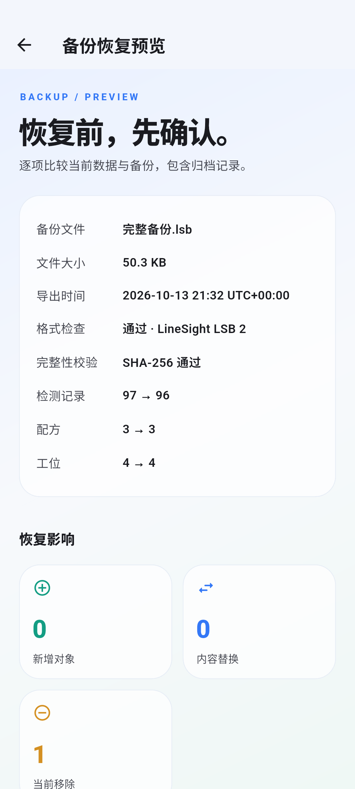
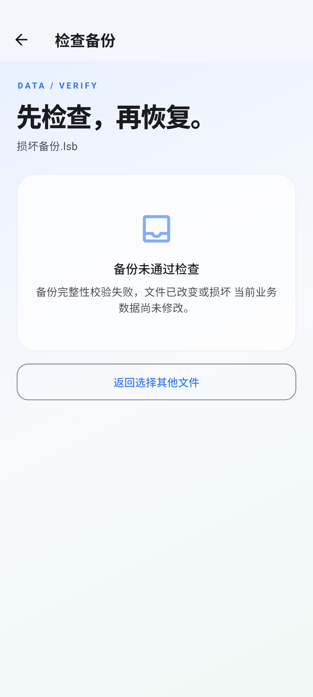
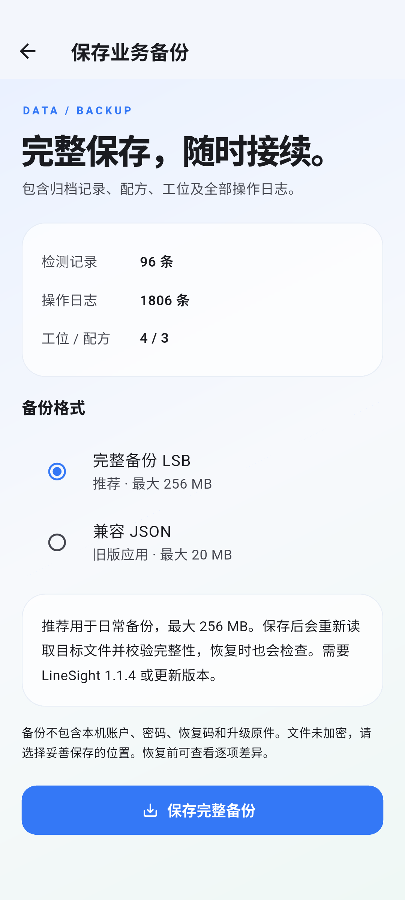
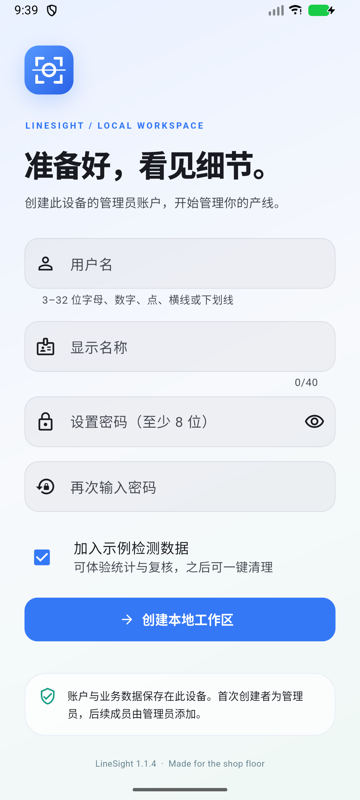

# LineSight 1.1.4

Actual Android emulator captures of complete backup selection, verified restore preview and rejection of a corrupted file. The import journey uses a small fixture to make the 97 → 96 record comparison clear; the separate native picker journey saves and reopens a complete backup larger than 20 MiB with 1,800 fixture audit events.

## Backup selection

The snapshot is taken when backup starts. LSB is the recommended complete format; compatible JSON remains available for older installations.

## Verified import and rejection

The journey confirms restore to 96 records and preserves the previous 97-record workspace as an undo point.

## Large workspace

This earlier capture comes from the native save/open/cancel journey, including a 35-second picker delay that locks the app while preserving the original export actor.

## Release cold launch

The x64 release APK was installed and cold-launched successfully. The version label is visible at the bottom. [Contact sheet](overview.jpg).

## Capture sources

- `integration_test/archive_import_journey_test.dart`, `--dart-define=CAPTURE_ARCHIVE_IMPORT=true`.
- `integration_test/archive_picker_test.dart`, `--dart-define=CAPTURE_ARCHIVE=true`, driven through Android DocumentsUI by `tool/drive_file_picker.py`.
- `test_driver/screenshots.dart` with `LINESIGHT_SCREENSHOT_DIR=screenshots/v1.1.4`.

The image surface is refreshed before capture so saved images show the settled route and theme. Both host and Android tests check the rendered backup label's dark foreground. Initial stale transition captures were replaced after visual inspection.
