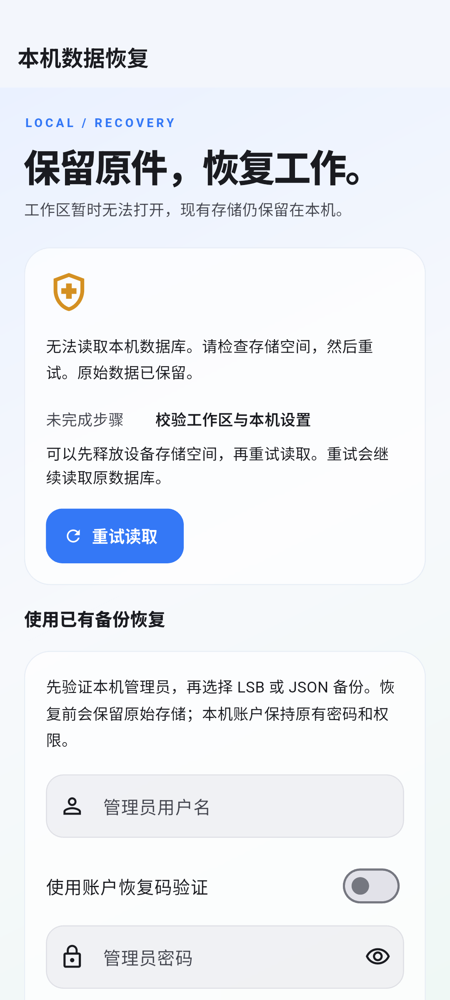
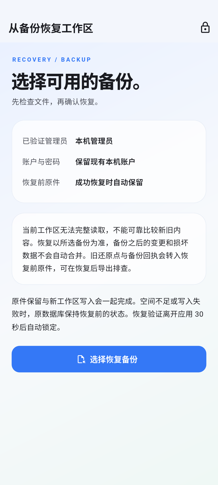
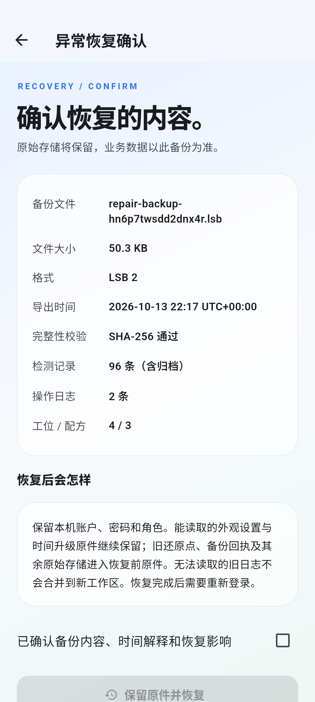
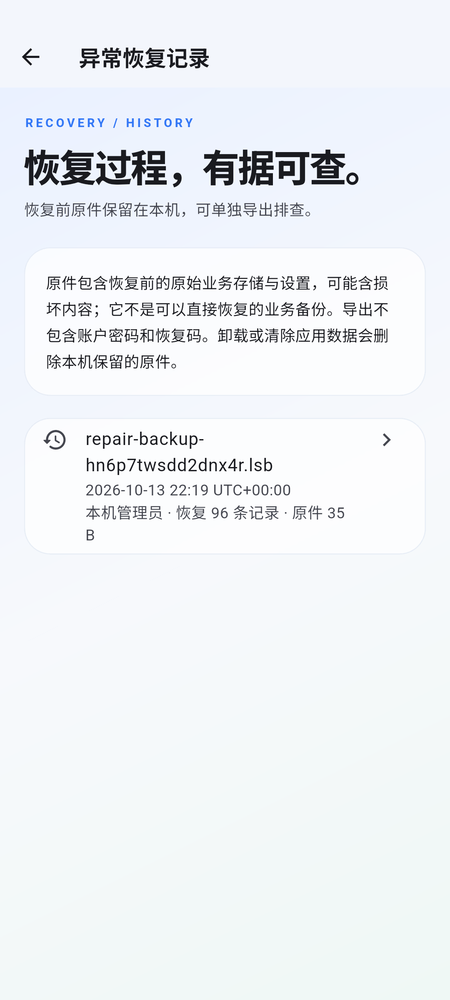
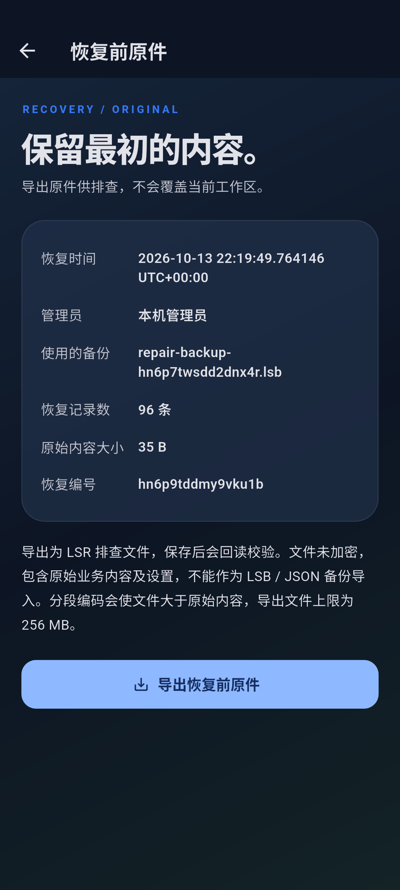
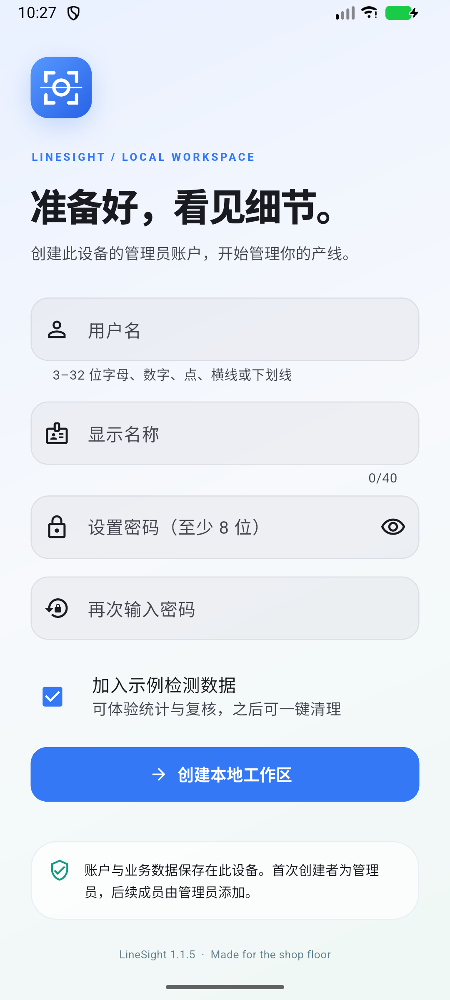

# LineSight 1.1.5

Actual Android emulator captures of authenticated startup recovery. The fixture deliberately replaces the workspace with 35 bytes of malformed data; a verified LSB restores 96 example inspections while keeping the original bytes and local accounts.

## Startup and administrator verification

Recovery verification uses an existing enabled administrator. It expires after 30 seconds away even when the normal automatic-lock preference is disabled.

## Recovery preview

The administrator acknowledges the backup and recovery consequences, then confirms preservation and replacement. Successful recovery requires normal login again.

## Recovery history and originals

The LSR export preserves raw bytes for diagnosis. It is separate from an importable business backup. Native destination readback verifies the saved file, and the export audit identifies the recovery record and initiating administrator after locking.

## Release cold launch

The x64 release APK installed successfully and launched with `Status: ok`, `LaunchState: COLD`. The visible version label reads 1.1.5. [Six-screen overview](overview.jpg).

## Capture sources

- `integration_test/storage_recovery_journey_test.dart`, `--dart-define=CAPTURE_RECOVERY=true`.
- `test_driver/screenshots.dart` with `LINESIGHT_SCREENSHOT_DIR=screenshots/v1.1.5`.
- `tool/drive_file_picker.py` drives actual Android DocumentsUI selection, save, reopening and cancellation; both open and save include a 35-second locking check.

The screenshot helper refreshes the image surface before capture so each saved image shows the settled route and theme.
