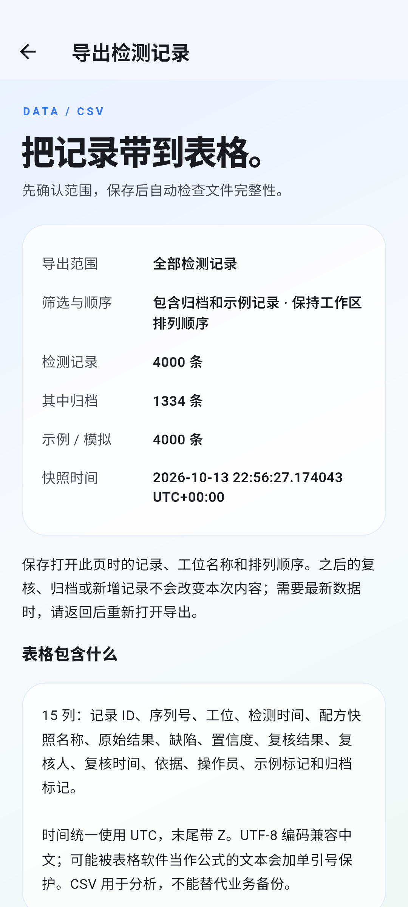
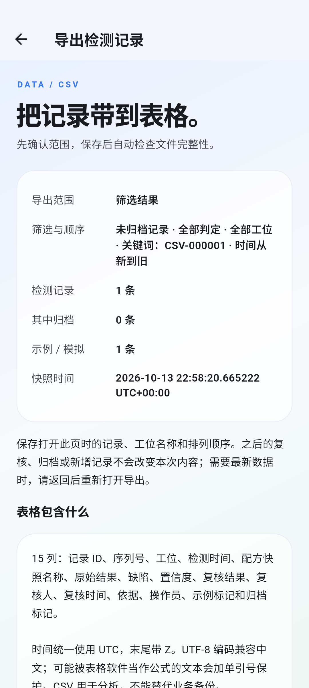
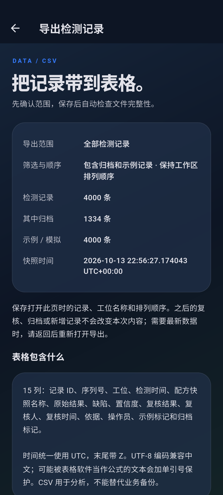
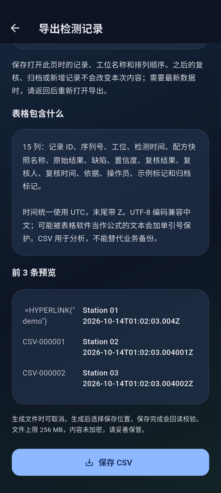
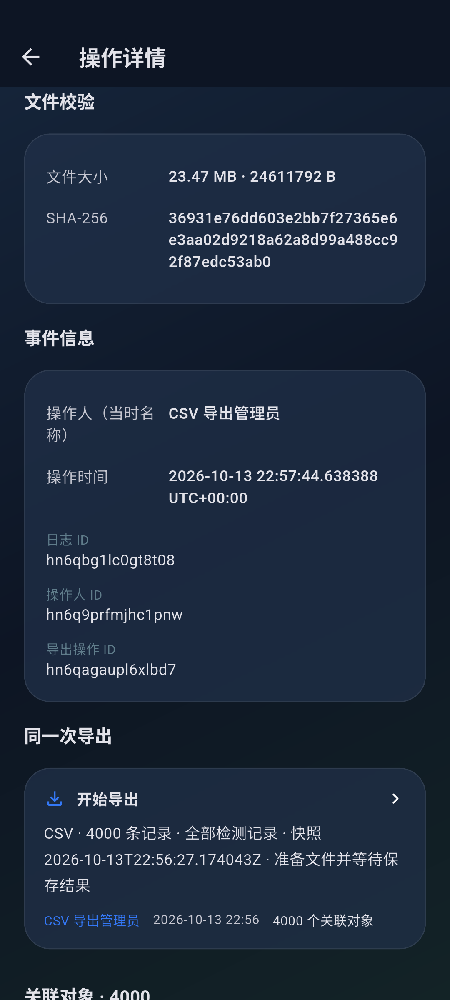
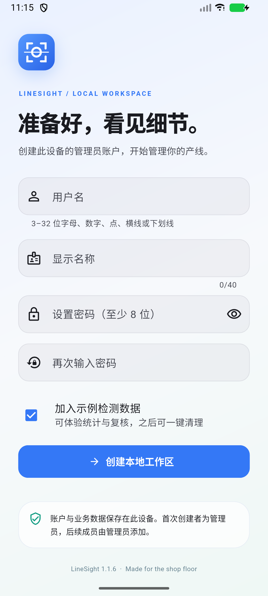

# LineSight 1.1.6

Actual Android captures of CSV selection previews and verified export history. The native journey uses 4,000 simulated records, including 1,334 archived rows. Its saved CSV is 24,611,792 bytes, beyond the older 20 MiB compatible-backup limit.

## Confirm the selection

The preview freezes row values, station names and order. The journey reviews a record after opening the all-record preview; the saved file retains the earlier values. Reopening through the filtered record list captures the newer review.

## Fields and appearance

The 15-column CSV includes UTC times, original and reviewed verdicts, and example/archive markers. It uses UTF-8 BOM, quoted cells and formula protection. Generation is cancellable; native saving verifies the destination before reporting success.

## Export history

The audit retains the initiating administrator after automatic locking, the selection's 4,000 record targets and the verified file metadata. It does not replace the last successful business-backup receipt.

## Capture sources

- `integration_test/csv_export_journey_test.dart`, `--dart-define=CAPTURE_CSV=true`.
- `test_driver/screenshots.dart` with `LINESIGHT_SCREENSHOT_DIR=screenshots/v1.1.6`.
- `tool/drive_file_picker.py` operates actual Android DocumentsUI save/open/cancel controls, including a 35-second save-picker delay and a deliberately incorrect-hash rejection.

The image surface is refreshed before capture. All fixture records remain explicitly marked as examples/simulations.

## Release first launch

Final normal-entrypoint x64 APK, installed and cold-launched successfully. Visible version: 1.1.6.

[Six-screen overview](overview.jpg). Captures and overview were visually reviewed.
