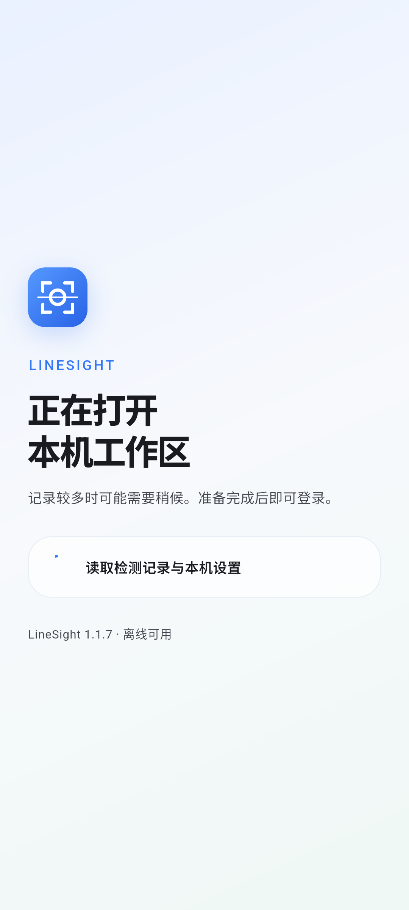
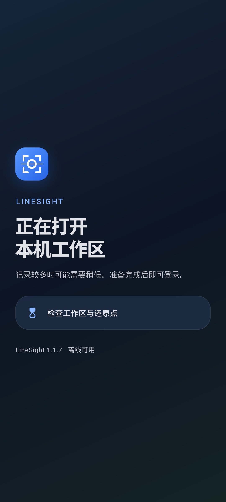
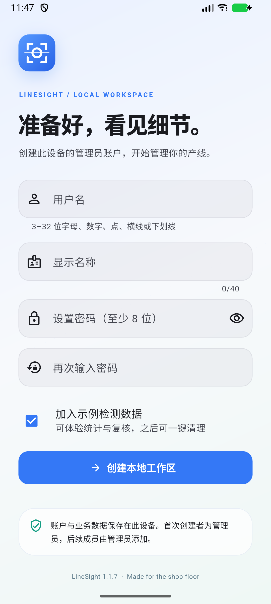

# LineSight 1.1.7 — startup

[Three-screen overview](overview.jpg)

## Loading status

These are actual Android renders from `integration_test/startup_ui_journey_test.dart`. The test holds the loading presentation state so the status and appearance can be captured consistently. It checks visible status text and the reduced-motion hourglass. It does not measure the duration of those displayed stages.

Database timings and exact-data checks come from the separate `startup_profile_test.dart`; see [measurement details](../../docs/STARTUP_PERFORMANCE.md) in the source workspace or the release's reports.

## Installed release

This capture comes from the installed normal-entrypoint release APK, after a successful cold launch. The footer identifies version 1.1.7. Source: ADB binary `screencap`, without text conversion.
